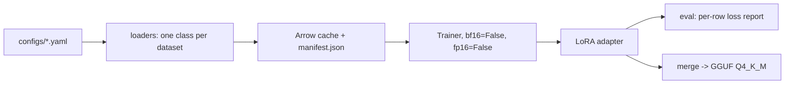

# Falcon-H1-3B Cyber QLoRA

[](https://github.com/sourcepirate/falcon-h1-finetune/actions/workflows/ci.yml)
[](https://www.python.org/)
[](https://huggingface.co/tiiuae/Falcon-H1-3B-Instruct)

Fine-tune [Falcon-H1-3B-Instruct](https://huggingface.co/tiiuae/Falcon-H1-3B-Instruct)
on seven public red-team / cyber-security datasets with QLoRA — one precision
end-to-end, no AMP, no dtype plumbing.

```bash
pip install -e ".[train]"
make smoke   # 400 rows -> 5 steps. Run this before anything else.
make train   # full run -> outputs/falcon-h1-3b-cyber
make eval    # per-sample loss, worst offenders, non-finite detection
make export  # merge -> f16 GGUF -> Q4_K_M
```

## How it works



Seven loader classes (`RedTeam`, `Kali`, `Kimi`, `CTI`, `ExploitDB`,
`LinuxCommands`, `Debian`) share one `LoaderBase`: fetch → cap → map rows to
chat messages → render with the model's chat template → dedupe → length-filter →
split → tokenise. The corpus is fingerprinted, so a config change invalidates
the cache instead of silently training on stale rows.

## Datasets

| Loader | Source | Rows (cap) |
|---|---|---|
| `RedTeam` | [WNT3D/Ultimate-Offensive-Red-Team](https://huggingface.co/datasets/WNT3D/Ultimate-Offensive-Red-Team) | 20,000 |
| `Kali` | [suryanshp1/kali-linux-pentesting-data](https://huggingface.co/datasets/suryanshp1/kali-linux-pentesting-data) | 343 |
| `Kimi` | [echel0nn1881/kimi-cyber-reasoning](https://huggingface.co/datasets/echel0nn1881/kimi-cyber-reasoning) | 997 |
| `CTI` | [reloading0101/threat-intelligence-dataset](https://huggingface.co/datasets/reloading0101/threat-intelligence-dataset) | 6,000 |
| `ExploitDB` | [Waiper/ExploitDB_DataSet](https://huggingface.co/datasets/Waiper/ExploitDB_DataSet) | 8,000 |
| `LinuxCommands` | [Romit2004/LinuxCommands](https://huggingface.co/datasets/Romit2004/LinuxCommands) | 6,000 |
| `Debian` | [2etatg/Debian_Hacking_Networking](https://huggingface.co/datasets/2etatg/Debian_Hacking_Networking) | 965 |

## Configs

| File | For | Precision | `max_len` |
|---|---|---|---|
| `configs/qlora-3b.yaml` | Ampere+ (A100, L4, RTX 30xx/40xx) | bf16 | 2048 |
| `configs/qlora-3b-t4.yaml` | Colab T4 | fp16 | 1024 |

LoRA: `r=32, alpha=16, dropout=0.05`, targets `q/k/v/o/in/gate/up/down_proj`.
Training: 4-bit NF4 base, `paged_adamw_8bit`, `lr=2e-4`, 1 epoch, cosine schedule.
`notebooks/run.ipynb` is the T4 entry point (`Run All` with `RUN_TRAIN = False` is safe).

## CLI

No command requires a flag (`--config` defaults to `configs/qlora-3b.yaml`):

```bash
python -m cyberft.cli info      # gpu, dtype, resolved config, corpus stats
python -m cyberft.cli data      # --smoke, --force
python -m cyberft.cli train     # --smoke
python -m cyberft.cli eval      # --smoke
python -m cyberft.cli export
```

## Library

Every stage is a function; the CLI and the notebook are thin wrappers over these.

```python
from cyberft import load_config, prepare_data, train, evaluate, generate, export_gguf, train_dir

cfg = load_config("configs/qlora-3b.yaml")     # validated dataclass

splits  = prepare_data(cfg, smoke=True)        # cached DatasetDict
trainer = train(cfg, smoke=True)               # returns transformers.Trainer, saves adapter
adapter = train_dir(cfg, smoke=True)           # where the adapter/checkpoints live

report = evaluate(cfg, smoke=True)             # EvalReport, one loss per row
print(report.summary())
report.assert_finite()                         # raises NonFiniteLossError, never returns nan

answers = generate(cfg, ["Write a tcpdump command for DNS only"], adapter=adapter)
path = export_gguf(cfg, adapter=adapter)       # Path to the quantized GGUF
```

Failures are typed exceptions (`ConfigError`, `NotBuiltError`, `DependencyError`,
`NonFiniteLossError`) — the library never parses arguments or calls `sys.exit`.

## Operating notes

- **Throughput** (T4, PyTorch Mamba fallback, no `mamba-ssm`): ~0.6 samples/s.
  Ampere with fused kernels is roughly 4–5× faster.
- **Resume**: `train.resume: true` picks up the newest checkpoint automatically.
- **Memory**: 4-bit base + LoRA + gradient checkpointing fits 16 GB at
  `micro_batch: 1`, `max_len: 2048`. Raise `micro_batch` before `max_len`.
- **Export RAM**: the CPU bf16 merge needs ~7 GB of host RAM.
- **CI**: ruff, mypy and the CPU tests run on every push; the GPU smoke test
  stays manual (`make smoke`).

## Troubleshooting

| Symptom | Cause | Action |
|---|---|---|
| `mat1 and mat2 shapes cannot be multiplied` in `mamba_split_conv1d_scan_combined` | Mamba `out_proj` was quantised and fed to the fused kernel | keep `out_proj` in `model.bnb_skip_modules` |
| `NonFiniteLossError` during training | loss went NaN at that step | stop; lower `lr`, check `max_len` |
| `NonFiniteLossError` during evaluation | one pathological row | `make eval` names the row; drop it in the loader class in `cyberft/loaders.py` |
| `NonFiniteLossError` on a T4 (fp16) | fp16 SSM arithmetic on a long row | lower `max_len` (try 768), then `lr` to 1e-4 |
| `No kernel image is available` from `mamba-ssm` | wrong CUDA arch | reinstall `requirements-fast.txt` on the target GPU |
| `ImportError: ... requires bitsandbytes` | runtime installed without the `train` extra | `pip install -e ".[train]"`, restart the kernel |

## Licence note

`reloading0101/threat-intelligence-dataset` is **CC-BY-NC-SA-4.0** (non-commercial);
check every source before commercial use. The base model ships under the Falcon-LLM
licence. Use the result only for authorised testing, research and education.
